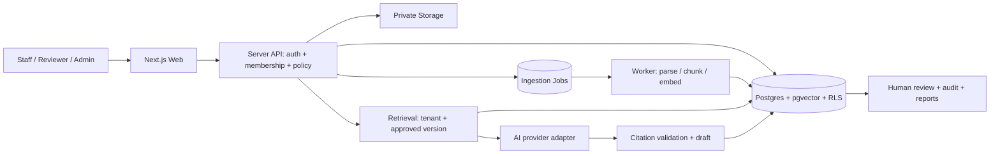

# สถาปัตยกรรมและ Tech Stack

สถานะ: ข้อเสนอสำหรับ MVP ไม่ใช่ stack ที่ติดตั้งแล้ว เดโมใช้ HTML/CSS/JavaScript เท่านั้น

## การตัดสินใจ

ใช้ modular monolith: Next.js + TypeScript สำหรับ UI และ API; Supabase สำหรับ Auth, PostgreSQL, private Storage และ pgvector. แยกโมดูล Identity, Knowledge, Tasks, Review, Reporting และ AI adapter ภายในแอปเดียว ลดภาระ deploy และไม่เพิ่ม vector service แยกใน pilot

| ชั้น | เทคโนโลยีเสนอ | เหตุผล/ข้อแลกเปลี่ยน |
|---|---|---|
| UI และ API | Next.js App Router + TypeScript | ใช้ภาษาเดียวและ Route Handlers; ต้องควบคุม server/client boundary และ cache ข้อมูลตามสิทธิ์ |
| UI styling | Tailwind CSS และ accessible primitives ตามต้องการ | ทำหน้าจอไทย responsive; ไม่จำเป็นต้องเพิ่ม component library ทุกส่วน |
| Database/Auth/Files | Supabase PostgreSQL + Auth + private Storage | ลดงาน infrastructure; ตรวจ region, backup และสัญญาข้อมูลก่อนเลือก hosting |
| Search | PostgreSQL full-text + pgvector | เริ่ม hybrid retrieval และ filter tenant/approval/วันมีผลก่อนค้น; ทดสอบภาษาไทยจริง ไม่ถือว่า semantic search แม่นเสมอ |
| Validation | Zod ฝั่ง server + DB constraints | validate request, enum, ขนาด และสิทธิ์; validation ฝั่ง UI มีไว้ช่วยผู้ใช้ |
| AI | Server-side provider adapter สำหรับ generation/embedding | เลือกโมเดลจาก eval ภาษาบัญชีไทยและ data terms; ไม่ล็อกชื่อโมเดล/ราคาโดยยังไม่ทดสอบ |
| Background work | Worker Node.js กับตาราง jobs ใน Postgres | ingestion/chunk/embed ทำแบบ asynchronous; retry จำกัด, idempotency, dead letter; เพิ่ม managed queue เมื่อโหลดพิสูจน์ว่าจำเป็น |
| Verify | Vitest, Playwright และ DB integration tests | ทดสอบ state, UI flow และ RLS จริงตามความเสี่ยง |
| Deploy | Node container + worker และ managed database | เลือก host หลังยืนยัน data location; ไม่เปิดบัญชีหรือซื้อบริการในงานนี้ |

ไม่เพิ่ม Python API, Kubernetes, microservices หรือ fine-tuning จนมีเหตุผลจาก workload. หากห้ามส่งข้อมูลออกองค์กร ต้องประเมิน self-hosted model/database แยก เพราะต้นทุนและภาระดูแลสูงขึ้น ไม่ใช่การสลับ config อย่างเดียว

## Data model เสนอ

ทุก business record มี id, organization_id, created_at, created_by. UUID เดาไม่ได้ไม่ใช่การควบคุมสิทธิ์

| Entity | Fields/relations สำคัญ |
|---|---|
| organizations | name, policy, retention_days, quota |
| memberships | organization_id + user_id unique, role, active |
| task_types / checklist_versions | label, schema, effective_version |
| knowledge_documents | owner, title, status, current_approved_version |
| knowledge_versions | document_id, version, text/hash, effective_from/to, approver |
| knowledge_chunks | version_id, content, embedding, organization_id |
| tasks | creator, reviewer, type, status, current_revision_id, lock_version |
| task_revisions | task_id, input, generated_text, edited_text, model_id, prompt_version |
| citations | revision_id, knowledge_version_id, chunk_id, excerpt |
| reviews | revision_id, reviewer_id, checklist snapshot/results, score, severity, decision, comment |
| knowledge_proposals | source_revision_id, proposed_text, status, curator |
| audit_events | actor, entity, event, revision, timestamp; append-only ผ่าน server |
| ai_runs / jobs | request_id unique, state, model, tokens, estimated_cost, retry_count |

ใช้ composite FK ที่รวม organization_id ป้องกันความสัมพันธ์ข้าม tenant; approval transaction ล็อก revision และเขียน review/status/audit พร้อมกัน unique approval ต่อ revision. RLS ตรวจ membership ที่ยัง active ทุก operation; worker ที่มี privileged key ต้องรับ tenant จาก job ที่ตรวจแล้ว ห้ามเชื่อ organization_id จาก request. ไฟล์ใช้ path tenant และ private policy; signed URL อายุสั้นหลังตรวจสิทธิ์

## API contract ร่าง

ทุก endpoint ตรวจ session, active membership, role, ownership/assignment และ validate input ฝั่ง server; organization มาจาก membership. 401 unauthenticated, 403 forbidden, 404 resource inaccessible, 409 stale revision/invalid state, 422 invalid input, 429 quota

| Method / endpoint | Contract |
|---|---|
| POST /api/tasks | title, type_id, input, reviewer_id → task draft |
| POST /api/tasks/:id/generate | expected_version + idempotency_key → run_id; poll สถานะได้ |
| POST /api/tasks/:id/submit | revision_id, expected_version → in_review |
| POST /api/tasks/:id/review | revision_id, expected_version, decision, checklist, score, comment, edited_text → transaction |
| POST /api/knowledge/proposals | source_revision_id, title, text → pending |
| POST /api/knowledge/:id/approve | version_id, expected_version → approved; curator only |
| GET /api/reports | from/to/type → aggregate scoped to tenant พร้อม sample size |
| GET /api/tasks/:id/audit | authorized timeline; no secrets/raw prompts of other tenants |

## AI pipeline

Input → ตรวจข้อมูล/ปิดบัง → retrieve approved knowledge ตาม tenant/type/date → สร้าง prompt แยกข้อมูลจากคำสั่ง → call model แบบ bounded output → validate citation IDs/ความครบถ้วน → เก็บร่างและ metadata → human review. หากค้นไม่ได้หรือ provider ล้มเหลว ให้แสดงเหตุผล ไม่แต่งแหล่งอ้างอิงและไม่อนุมัติอัตโนมัติ

Retrieval เริ่มจาก hybrid top-k แล้ววัด recall ด้วยชุดคำถามจริง การเปลี่ยน embedding ต้อง re-index แบบมีรุ่น ไม่ทับ index ที่ยังใช้ โมเดลเปลี่ยนต้องรัน eval ใหม่ ไม่รวมคะแนนข้ามรุ่นโดยไม่แสดงรายละเอียด

## เอกสารทางการที่ตรวจประกอบการเลือก

ตรวจ 3 พฤศจิกายน 2569; เลือก stable versions และ pin lockfile เมื่อเริ่ม implementation ไม่อ้างว่าใช้ latest

- [Next.js Route Handlers](https://nextjs.org/docs/app/getting-started/route-handlers) รองรับ API ภายใน App Router
- [Supabase Row Level Security](https://supabase.com/docs/guides/database/postgres/row-level-security) ใช้ policy ร่วมกับ Auth; ต้องทดสอบ policy จริง
- [Supabase RAG with Permissions](https://supabase.com/docs/guides/ai/rag-with-permissions) อธิบายการควบคุม retrieval ด้วย Postgres/pgvector และ RLS
